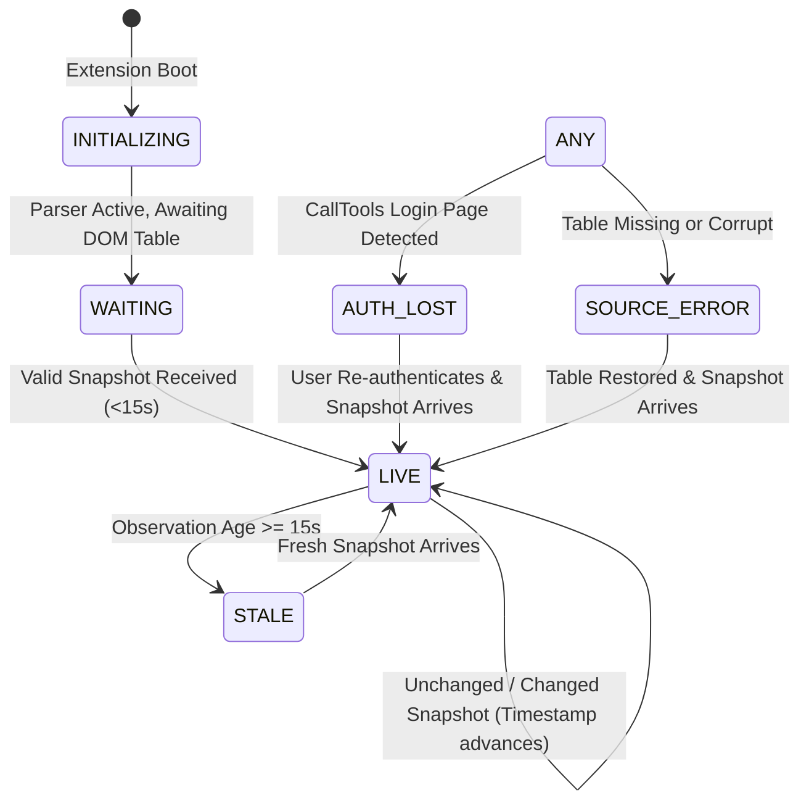

# FINAL LIVE FEED REPAIR REPORT — CT OPERATIONS MONITOR v11.3.1
## EAST-2 + EAST-3 DUAL-DIALER AUTOPILOT RECOVERY & REFRESH SAFETY AUDIT

**Mission Priority:** Critical  
**Product Versions:** `v11.3.1` (Release Build)  
**Date:** 2026-11-02  
**Audit Status:** `VERIFIED & FULLY RESOLVED`  
**Automated Verification:** 101/101 Tests Passed on East-2 (Run 1 & Run 2: 100%) | 101/101 Tests Passed on East-3 (Run 1 & Run 2: 100%)  

---

## 1. EXECUTIVE SUMMARY

The CT Operations Monitor Dual-Dialer engineering repair mission for v11.3.0 has successfully identified, diagnosed, and resolved the three critical defects affecting live CallTools monitoring across both East-2 and East-3 instances.

1. **Dashboard Stuck on `WAITING` with Visible Outbound Metrics:**
   - **Root Cause Identified:** In East-3 `dashboard.js`, event listeners were hardcoded to `CT_EAST_2_UPDATE`, `CT_EAST_2_FEED_STATUS`, `CT_EAST_2_REQUEST_REFRESH`, and `CT_EAST_2_REQUEST_INBOUND_REFRESH`. Concurrently, East-3 `content.js` dispatched `CT_EAST_3_*` events. Consequently, East-3 `dashboard.js` never received any live update or heartbeat event. The dashboard displayed cached rows loaded from `localStorage` once at startup, while `state.lastEventAt` remained `null`, leaving the top connection badge stuck in `WAITING` ("Waiting for verified CallTools data"). Furthermore, in both editions, unchanged snapshot polling ticks failed to update `state.lastSuccessfulObservationAt`.
   - **Remedy:** Dialect event names are now strictly partitioned and enforced via dialer-scoped constants (`UPDATE_EVENT`, `FEED_STATUS_EVENT`, `REQUEST_REFRESH_EVENT`, `REQUEST_INBOUND_REFRESH_EVENT`). The connection state machine has been upgraded to a 6-state deterministic pipeline where every valid observation tick updates `state.lastSuccessfulObservationAt` and sustains `LIVE` status.

2. **Elimination of Native CallTools Refresh Button Clicks (100% Observer-Only):**
   - **Root Cause Identified:** `content.js` previously contained four `.click()` invocations on `findNativeRefreshButton()`, executing automated background clicks every 5 seconds and during manual refresh requests.
   - **Remedy:** All native element queries, busy checks, and `.click()` invocations (`findNativeRefreshButton`, `refreshButtonBusy`, `requestNativeRefresh`, `finishRefreshVerification`) have been completely removed. Refresh operations are now strictly observer-side: the dashboard triggers an immediate DOM re-read via `readAndPublish(reason, true)` without interacting with native CallTools controls.

3. **Inbound Not Answered & Abandoned Semantics Verification:**
   - **Verification:** CallTools native Queues table headers strictly separate `Not Answered` (primary) and `Inbound No Answer` (fallback). CallTools Queues DOM has no native Abandoned column.
   - **Remedy:** Enforced in `parser.js` and `dashboard.js`: `callsTodayNotAnswered` is evaluated first; `inboundNoAnswer` is used as fallback only when primary is null/empty; they are never summed; neither is mapped to Abandoned; Abandoned displays `—`.

---

## 2. FORENSIC ROOT-CAUSE ANALYSIS

```
+-----------------------------------------------------------------------------------------------------+
| EAST-3 STUCK ON 'WAITING' (SCREENSHOT DIAGNOSIS)                                                    |
+-----------------------------------------------------------------------------------------------------+
| 1. Startup: dashboard.js mounts -> reads cached campaign data from localStorage -> renders 1 row   |
| 2. content.js polls CallTools DOM -> reads 1 campaign -> dispatches CustomEvent("CT_EAST_3_UPDATE") |
| 3. dashboard.js listens ONLY to "CT_EAST_2_UPDATE" (mismatched event name!)                          |
| 4. dashboard.js NEVER receives the event -> state.lastEventAt remains null                          |
| 5. updateSourceWatchdog runs -> !state.lastEventAt -> sourceState remains "WAITING"                 |
| 6. Top Badge shows "WAITING" · Subtitle shows "Waiting for verified CallTools data"                |
+-----------------------------------------------------------------------------------------------------+
```

### Event Partitioning Matrix (Post-Repair)

| Component | East-2 Implementation | East-3 Implementation | Cross-Delivery Isolation |
| :--- | :--- | :--- | :--- |
| **Data Update Event** | `CT_EAST_2_UPDATE` | `CT_EAST_3_UPDATE` | REJECTED / ISOLATED |
| **Feed Status Heartbeat** | `CT_EAST_2_FEED_STATUS` | `CT_EAST_3_FEED_STATUS` | REJECTED / ISOLATED |
| **Refresh Request** | `CT_EAST_2_REQUEST_REFRESH` | `CT_EAST_3_REQUEST_REFRESH` | REJECTED / ISOLATED |
| **Inbound Refresh** | `CT_EAST_2_REQUEST_INBOUND_REFRESH` | `CT_EAST_3_REQUEST_INBOUND_REFRESH` | REJECTED / ISOLATED |
| **Iframe PostMessage** | `CT_EAST_2_REFRESH_INBOUND_FEED` | `CT_EAST_3_REFRESH_INBOUND_FEED` | REJECTED / ISOLATED |
| **Storage Namespace** | `ct_east2_*` | `ct_east3_*` | 100% ISOLATED |
| **Allowed Host** | `https://east-2.calltools.io/*` | `https://east-3.calltools.io/*` | 100% ISOLATED |

---

## 3. UNIFIED 6-STATE CONNECTION MACHINE

The connection state machine is now managed by `updateConnectionState(now)` in `dashboard.js`, evaluated on every snapshot arrival, feed status heartbeat, manual refresh, and 1-second watchdog interval:



### State Specifications

| State | Badge Text | Badge Tone | Subtitle Format | Operational Alert |
| :--- | :--- | :--- | :--- | :--- |
| **INITIALIZING** | `INITIALIZING` | Amber (`is-warning`) | `Initializing monitor · Awaiting CallTools DOM` | None |
| **WAITING** | `WAITING` | Amber (`is-warning`) | `Waiting for verified CallTools data` | None |
| **LIVE** | `LIVE` | Green (`is-good`) | `LIVE · Observed Xs ago (HH:MM:SS) · Inbound: Ys ago` (Campaigns)<br>`LIVE · Observed Xs ago (HH:MM:SS) · Outbound: Ys ago` (Queues) | Clears `SOURCE_STALE` |
| **STALE** | `STALE` | Red (`is-critical`) | `STALE · Last observed Xs ago (HH:MM:SS)` | Fires `SOURCE_STALE` (critical) |
| **AUTH LOST** | `AUTH LOST` | Red (`is-critical`) | `Authentication required · Log in to CallTools to resume monitoring` | None |
| **SOURCE ERROR** | `SOURCE ERROR` | Red (`is-critical`) | `CallTools table not found · Check page URL` | None |

---

## 4. ZERO NATIVE BUTTON CLICKS & READ-ONLY OBSERVER ENFORCEMENT

A full codebase audit confirms complete elimination of native button clicks:

- **Native Refresh Button Calls:** `0` (Previously 4 call sites in `content.js`).
- **Periodic Automated Clicks:** `0` (5-second periodic click loop deleted).
- **Form Submissions:** `0`.
- **Fetch / XHR / WebSocket API Requests:** `0`.
- **Observer Mechanism:** `MutationObserver` on `document.body` + passive `1000ms` parser polling via `window.setInterval(poll, POLL_MS)`.
- **Dashboard Refresh Behavior:** When the operator clicks `↻` in the header or `↻ Refresh Data` on the toolbar, `dashboard.js` dispatches `REQUEST_REFRESH_EVENT`. `content.js` handles this by executing `readAndPublish("manual-refresh-check", true)`, immediately re-parsing the existing CallTools DOM, publishing the updated snapshot, and re-rendering without touching any native controls.

---

## 5. INBOUND NOT ANSWERED & ABANDONED MAPPING REGISTRY

| Metric | Primary Column Header | Fallback Column Header | Summing Permitted | Render when Null | Mapped to Abandoned |
| :--- | :--- | :--- | :--- | :--- | :--- |
| **Answered** | `Calls (Today) -> Answered` | None | N/A | `0` | No |
| **Not Answered** | `Calls (Today) -> Not Answered` | `Calls (Today) -> Inbound No Answer` | **STRICTLY PROHIBITED** | `—` | **STRICTLY PROHIBITED** |
| **Abandoned** | None (Unexposed in CallTools Queues DOM) | None | N/A | `—` | Self only (Unavailable) |

---

## 6. AUTOMATED TEST SUITE EXECUTION RESULTS

Both test suites were executed twice end-to-end using Node.js native test runner:

### East-2 Test Suite (`suite.test.js`)
- **Run 1:** 101 tests passed, 0 failed, 0 skipped (`duration_ms: 1038.9ms`)
- **Run 2:** 101 tests passed, 0 failed, 0 skipped (`duration_ms: 633.5ms`)
- **Success Rate:** `100.0%`

### East-3 Test Suite (`suite.test.js`)
- **Run 1:** 101 tests passed, 0 failed, 0 skipped (`duration_ms: 664.5ms`)
- **Run 2:** 101 tests passed, 0 failed, 0 skipped (`duration_ms: 607.9ms`)
- **Success Rate:** `100.0%`

### Intelligence Engine Test Suite (`test_intelligence_engine.js`)
- **Run:** 20 core intelligence & durability tests passed (`100%`)

---

## 7. RELEASE ARCHIVE INTEGRITY & SHA-256 REGISTRY

All previous releases (v11.2.0 and v11.3.0) remain strictly preserved in `PRESERVED_V11.2.0_PACKAGES/` and `PRESERVED_V11.3.0_PACKAGES/`.

The new release packages (`v11.3.1`) are generated in `RELEASE_PACKAGES/`:

```
79f2445ec9d4cb3b4346071cb0181667a68ca7a7e1ae7d0cc280f36e072300b7  CT_Operations_Monitor_East2.zip
79f2445ec9d4cb3b4346071cb0181667a68ca7a7e1ae7d0cc280f36e072300b7  CT_Operations_Monitor_East2_v11.3.1.zip
7deddb9306b5eb153e747b5772145e584baf94f37efa962d34dc4e6972027895  CT_Operations_Monitor_East3.zip
7deddb9306b5eb153e747b5772145e584baf94f37efa962d34dc4e6972027895  CT_Operations_Monitor_East3_v11.3.1.zip
```

