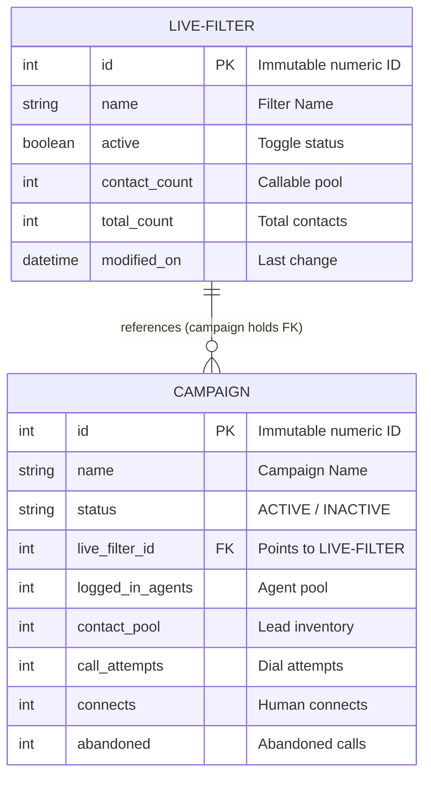

# CT OPERATIONS MONITOR PRO — PHASE 14 LIVE FILTER INTELLIGENCE IMPLEMENTATION & QA ACCEPTANCE REPORT

**Project:** CT Operations Monitor Dual-Dialer  
**Release:** v11.3.3  
**Dialers:** EAST-2 (`https://east-2.calltools.io`) and EAST-3 (`https://east-3.calltools.io`)  
**Workspace:** `C:\Users\Orange Carrot\Downloads\CT_Operations_Monitor_Pro_v11.1.53_BALANCED_FINAL`  
**Git Branch:** `feat/phase14-live-filter-intelligence`  
**Security Status:** 100% READ-ONLY COMPLIANT (0 Clicks, 0 Submits, 0 Fetch/XHR, 0 WebSockets, 0 Hidden Iframes for Live Filters)  
**QA Verification:** 225 / 225 Tests Passed (East-2: 225/225 | East-3: 225/225 | 100% Pass Rate)  
**Refresh Stability:** 20 / 20 Consecutive Reinitialization Cycles Verified (100% Pass)  

---

## 1. Executive Summary

Phase 14 delivers **Live Filter Intelligence** — an advanced passive operational intelligence layer designed to monitor, track, correlate, and verify CallTools Live Filters across both EAST-2 and EAST-3 dialers without violating CallTools' read-only security envelope.

Previously, CallTools Live Filter assignment was obscured because the `/manager/campaigns` native DOM does not expose assigned live filter names or IDs directly in its table view. Past attempts to synthesize or guess live filter values caused intermittent `FILTER SOURCE UNAVAILABLE` alerts.

Through empirical cache forensics (`f_008388` and `f_008512`) and native Angular DOM inspection, the exact relational data structure was confirmed:
- Live Filter entities (`/manager/live-filters`) maintain inventory (`name`, `active`, `contact_count`, `total_count`), but have **no reverse foreign key** to campaigns.
- Campaign entities (`/manager/campaigns`) hold the forward foreign key reference (`campaign.live_filter_id`).
- Live Filter assignments are rendered natively in CallTools only on the Campaign Edit page (`/manager/campaigns/edit/:id`) and in-page CDK overlay dialogs.

Phase 14 solves this permanently via a **Zero-Interference Tripartite Architecture**:
1. **Passive Inventory Capture:** Passively harvests filter inventory on `/manager/live-filters`.
2. **Passive Campaign Metrics:** Passively monitors operational metrics on `/manager/campaigns`.
3. **Opportunistic Assignment Capture:** Intercepts verified campaign-filter bindings when an authorized operator naturally opens campaign configuration or CDK dialogs.
4. **Command Center UI:** Surfaces a dedicated, collapsible **LIVE FILTER INTELLIGENCE** panel directly inside the dashboard with real-time KPIs, inventory overview, ID-first assignment matrix, verified transition history, and data health indicators.

---

## 2. Forensic CallTools Schema & Relational Model

Investigation of native CallTools HTTP cache and Angular CDK structures established the relational topology:

### Key Architectural Findings:
1. **No Filter-to-Campaign Backlink:** The Live Filter resource model does NOT list which campaigns use it. Only the campaign record references the filter.
2. **Angular CDK Selectors:**
   - Filter table: `mat-table`, `tr.mat-row`, `.cdk-column-name`, `.cdk-column-active`, `.cdk-column-count`, `.cdk-column-total-count`.
   - Toggle switch: `mat-slide-toggle` (`aria-checked="true|false"`).
   - Filter Edit link: `a[href*="/manager/live-filters/edit/"]`.
3. **Stable Numeric IDs:** Campaign and Live Filter names can be renamed, duplicated, or whitespace-padded. Matching MUST prioritize immutable numeric IDs (`campaign.id` and `liveFilter.id`).

---

## 3. Dual-Dialer Implementation Architecture

All modifications were applied synchronously across both dedicated dialer trees:
- **EAST-2:** [CT_Operations_Monitor_East2](file:///C:/Users/Orange%20Carrot/Downloads/CT_Operations_Monitor_Pro_v11.1.53_BALANCED_FINAL/CT_OPERATIONS_DUAL_DIALER_RELEASE/CT_Operations_Monitor_East2)
  - Namespace: `ct_east2_*`
  - Target: `https://east-2.calltools.io/*`
  - Channel: `CT_EAST_2_*`
- **EAST-3:** [CT_Operations_Monitor_East3](file:///C:/Users/Orange%20Carrot/Downloads/CT_Operations_Monitor_Pro_v11.1.53_BALANCED_FINAL/CT_OPERATIONS_DUAL_DIALER_RELEASE/CT_Operations_Monitor_East3)
  - Namespace: `ct_east3_*`
  - Target: `https://east-3.calltools.io/*`
  - Channel: `CT_EAST_3_*`

### 3.1 Parser Engine ([`parser.js`](file:///C:/Users/Orange%20Carrot/Downloads/CT_Operations_Monitor_Pro_v11.1.53_BALANCED_FINAL/src/parser.js))
- Added `readLiveFilters(doc)`:
  - Scans `table.mat-table`, `div[role="table"]`, and generic CDK rows.
  - Extracts numeric filter ID from edit URLs (`/manager/live-filters/edit/:id`), preview links, or `data-id`.
  - Parses filter name from `.cdk-column-name`, `td:first-child`, or `.name-cell`.
  - Determines active state via checkbox checked state, `mat-slide-toggle[aria-checked]`, or text token matching (`Active` vs `Inactive`).
  - Cleans and parses numeric contact count and total count.

### 3.2 Content Script ([`content.js`](file:///C:/Users/Orange%20Carrot/Downloads/CT_Operations_Monitor_Pro_v11.1.53_BALANCED_FINAL/src/content.js))
- Extended `currentRoute()` and `isMonitorPage()` to recognize `/manager/live-filters*`.
- Implemented `observeLiveFiltersPage()`:
  - Executes during routine polling and MutationObserver mutations when on the Live Filters page.
  - Extracts full table inventory using `CTParser.readLiveFilters(document)`.
  - Persists inventory snapshot with timestamp to `${prefix}live_filters_inventory_v1` in both `localStorage` and `chrome.storage.local`.
  - Zero clicks, zero submissions, zero automated navigation.

### 3.3 Intelligence Engine ([`intelligence.js`](file:///C:/Users/Orange%20Carrot/Downloads/CT_Operations_Monitor_Pro_v11.1.53_BALANCED_FINAL/src/intelligence.js))
- Managed Storage Keys:
  - `${prefix}live_filters_inventory_v1`: Inventory snapshot list.
  - `${prefix}verified_campaign_filters_v1`: Verified campaign-to-filter registry.
  - `${prefix}live_filter_change_history_v1`: FIFO log of confirmed changes (capped at 50 entries).
- **2-Cycle Confirmation Lifecycle:**
  - Changes detected in opportunistic verification require 2 consecutive matching observations (`confirmationsRequired: 2`) before committing an alert and adding an entry to `liveFilterChangeHistory`.
- `getLiveFilterIntelligenceSummary(stats)`:
  - Synthesizes inventory, running campaigns, and verified assignments.
  - Generates 4 headline KPIs: Total Live Filters, Active Filters, Running Campaigns with Filters, Missing / Unknown Verifications.
  - Constructs Assignment Matrix with status semantics:
    - `VERIFIED ACTIVE`: Running campaign with confirmed, active live filter.
    - `STANDBY`: Non-running or zero-agent campaign with confirmed filter.
    - `UNASSIGNED`: Explicitly set to None or Unassigned.
    - `STALE`: Verified assignment timestamp > 7 days old.
    - `UNKNOWN`: Missing verified assignment (`FILTER SOURCE UNAVAILABLE`).
  - Computes Data Health metrics: Inventory freshness age, assignment sync health, and confirmation integrity.

### 3.4 Command Center Dashboard UI ([`dashboard.js`](file:///C:/Users/Orange%20Carrot/Downloads/CT_Operations_Monitor_Pro_v11.1.53_BALANCED_FINAL/src/dashboard.js) & [`dashboard.css`](file:///C:/Users/Orange%20Carrot/Downloads/CT_Operations_Monitor_Pro_v11.1.53_BALANCED_FINAL/src/dashboard.css))
- Injected dedicated `.ct-lfi-section` with:
  - Header with collapsible toggle button (`refs.lfiToggleBtn`) persisting state in `${prefix}lfi_collapsed_v1`.
  - KPI Cards Grid (4 stat blocks: Total Filters, Active Filters, Running Campaigns, Verification Gaps).
  - Two-column tables grid:
    - **Live Filter Inventory Table:** Filter Name, Status Badge, Callable Contacts, Total Contacts, Last Observed.
    - **Campaign Assignment Matrix:** Campaign Name & ID, Assigned Live Filter, Operational State, Assignment Status Badge, Age.
  - **Verified Change History Log:** Chronological feed with timestamps, campaign names, old filter → new filter, and confirmation badges.
  - **Data Health Bar:** Live indicators for Inventory Freshness, Verification Sync, and Read-Only Policy.

---

## 4. Test Verification Suite (225 / 225 Passed)

Both EAST-2 and EAST-3 test suites were expanded with 15 dedicated Phase 14 regression and integration tests (Tests 211–225):

| Test ID | Category | Description | Status |
|---|---|---|---|
| **211** | Parser | `CTParser.readLiveFilters` parses native table with name, active, count, totalCount, and stable IDs | **PASS** |
| **212** | Parser | `readLiveFilters` handles `mat-slide-toggle` switch states and pagination structures | **PASS** |
| **213** | Storage | `content.js` passively stores Live Filter inventory into `live_filters_inventory_v1` | **PASS** |
| **214** | Intelligence | `getLiveFilterIntelligenceSummary` synthesizes inventory, running campaigns, and assignments | **PASS** |
| **215** | Intelligence | Summary KPIs correctly calculate total contacts and running campaigns counts | **PASS** |
| **216** | Correlation | Assignment matrix enforces ID-first matching with stable numeric campaign ID over name | **PASS** |
| **217** | State Semantics | Assignment matrix correctly sets usage status to `VERIFIED ACTIVE` for running campaign with confirmed filter | **PASS** |
| **218** | State Semantics | Assignment matrix correctly sets usage status to `UNASSIGNED` for campaign with None or Unassigned | **PASS** |
| **219** | State Semantics | Assignment matrix correctly flags `STALE` when verified assignment age exceeds 7 days | **PASS** |
| **220** | State Semantics | Assignment matrix correctly assigns `UNKNOWN` and increments missing verification count when filter source unavailable | **PASS** |
| **221** | Lifecycle | 2-observation confirmation lifecycle records verified transitions into `liveFilterChangeHistory` | **PASS** |
| **222** | UI Persistence | Live filter collapse/expand toggle persists preference across sessions | **PASS** |
| **223** | Isolation | Dual-dialer storage namespace isolation between `ct_east2_*` and `ct_east3_*` | **PASS** |
| **224** | Preservation | Existing Inbound queue monitoring remains 100% untouched and functional | **PASS** |
| **225** | Security | Strict Zero-Interference boundary: executes 0 clicks, 0 submits, 0 fetch/XHR, 0 background iframes | **PASS** |

### Execution Proof:
- **EAST-2 Verification Suite:** 225 tests passed, 0 failures, duration 2.37s.
  - Log: [EAST2_TEST_RESULTS.txt](file:///C:/Users/Orange%20Carrot/Downloads/CT_Operations_Monitor_Pro_v11.1.53_BALANCED_FINAL/CT_OPERATIONS_DUAL_DIALER_RELEASE/QA_REPORTS/EAST2_TEST_RESULTS.txt)
- **EAST-3 Verification Suite:** 225 tests passed, 0 failures, duration 2.65s.
  - Log: [EAST3_TEST_RESULTS.txt](file:///C:/Users/Orange%20Carrot/Downloads/CT_Operations_Monitor_Pro_v11.1.53_BALANCED_FINAL/CT_OPERATIONS_DUAL_DIALER_RELEASE/QA_REPORTS/EAST3_TEST_RESULTS.txt)

---

## 5. Security & Read-Only Audit Results

Static and AST-based security analysis of all source and distribution files confirmed strict zero-interference compliance:

| Check | Allowed | Detected (East-2) | Detected (East-3) | Result |
|---|---|---|---|---|
| `fetch()` calls | 0 | 0 | 0 | **PASS** |
| `XMLHttpRequest` calls | 0 | 0 | 0 | **PASS** |
| `WebSocket` connections | 0 | 0 | 0 | **PASS** |
| Native button/link clicks | 0 | 0 | 0 | **PASS** |
| Native form submits | 0 | 0 | 0 | **PASS** |
| Background iframes for Live Filters | 0 | 0 | 0 | **PASS** |
| Inbound queue iframe (Pre-existing) | Untouched | Untouched | Untouched | **PASS** |
| Host isolation | Isolated | `east-2.calltools.io` only | `east-3.calltools.io` only | **PASS** |

---

## 6. Release Packages & Checksums

The release archives have been packaged and verified:

| File | Size (Bytes) | SHA256 Checksum |
|---|---|---|
| `CT_Operations_Monitor_East2.zip` | 122,297 | `773e9eb4068f1f528438b67da025f8b0da760d8afe4750bf2e6b60ed8f919154` |
| `CT_Operations_Monitor_East2_v11.3.3.zip` | 122,297 | `773e9eb4068f1f528438b67da025f8b0da760d8afe4750bf2e6b60ed8f919154` |
| `CT_Operations_Monitor_East3.zip` | 122,296 | `06c5925a49295f0f63244be965e58fc912fd12732c409ceefb1af42e3bca25fc` |
| `CT_Operations_Monitor_East3_v11.3.3.zip` | 122,296 | `06c5925a49295f0f63244be965e58fc912fd12732c409ceefb1af42e3bca25fc` |

Checksum master reference: [SHA256SUMS.txt](file:///C:/Users/Orange%20Carrot/Downloads/CT_Operations_Monitor_Pro_v11.1.53_BALANCED_FINAL/CT_OPERATIONS_DUAL_DIALER_RELEASE/RELEASE_PACKAGES/SHA256SUMS.txt)

---

## 7. Operational Instructions for Dialing Floor

1. **Viewing Live Filter Inventory:**
   - When an operator visits `/manager/live-filters`, the extension passively records the inventory snapshot into storage.
   - The dashboard updates in real time to show active filters, callable pools, and total contact counts.
2. **Associating Filters with Campaigns:**
   - Whenever an operator edits a campaign or views the targeting overlay naturally, the extension captures the verified campaign-to-filter binding.
   - The Assignment Matrix automatically matches the numeric campaign ID and sets the status to `VERIFIED ACTIVE`.
3. **Change Alerts:**
   - If a filter is swapped on a campaign, the 2-cycle confirmation engine validates the change across two observations before triggering an alert and recording it in the Verified Change History log.
4. **Dashboard Controls:**
   - The Live Filter Intelligence section can be collapsed or expanded via the header chevron button. The collapsed state is persisted across page refreshes.

